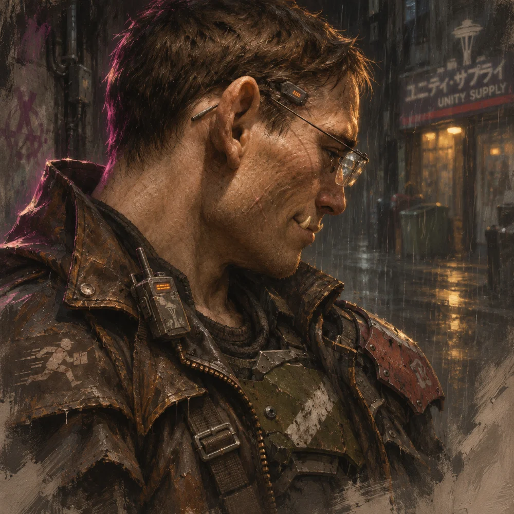

# Runner Forge

<p style="max-width: min(210px, 30%); margin-left: 0.5rem; float: right;"></p>
Every run starts with a name, a loadout, and a credstick. Runner Forge is your offline workbench for **Shadowrun Anarchy 2.0**. Build your runner by hand, let the generator put together a draft, and see how much nuyen you’ve got left before you hit the street. Your browser keeps the local saves.

https://rickard80.github.io/runnerforge/

## Local install
Extract the archive, open a terminal in this directory, and run:

```sh
python3 -m http.server 8000
```

Then visit http://localhost:8000.

## Identity and character generation

First, give the crew something to call you. On **Identity**, enter your **Street name**, then pick a **Metatype** and **Level of play**. Your play level determines how much nuyen you get and how high you can push your starting ratings.

- **New blank character** gives you a fresh runner with attributes at 2. You’ll get a confirmation before the current draft is cleared.
- **Generate character** replaces the current draft. Pick a **Role family**, a **Concept** or let **Random** make the call.

### Portrait

Give the crew a face to look for at the meet. The crop goes on the sheet and travels with local saves and JSON exports.

## Save, load, and transfer characters

| Action | What it does |
| --- | --- |
| **Load saved character…** | Pulls a runner out of your local stash. |
| **Save** | Stashes the draft in this browser under its street name. |
| **Delete saved** | Removes the associated local save and leaves the draft open. |
| **Import JSON** | Opens a character file as the current draft. |
| **Export JSON** | Downloads the full draft, including the portrait. |

Your stash belongs to this browser profile and site address.

## Print or save as PDF

When the crew’s ready to move, open **Print** to see the finished sheet. Hit **Print / Save as PDF** there or **Print / PDF** in the header. Allow pop-ups if the print window is blocked.